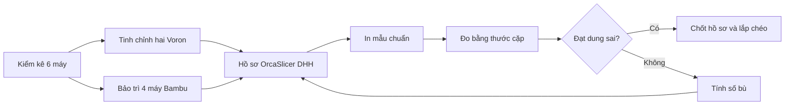
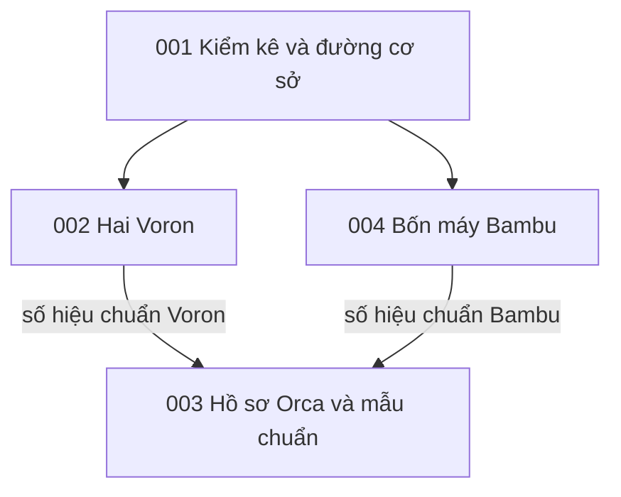

# DHH 3D Printers

Tối ưu và giữ đồng bộ dàn 6 máy in 3D (2 Voron chạy Klipper, 4 Bambu Lab) để cùng một file in ra chi tiết cùng kích thước trên máy nào cũng được. Repo này là thư mục làm việc và bản sao lưu của dự án.

Cập nhật lần cuối: 2026-11-24


> [!NOTE]
> Tính đến 2026-11-24: kế hoạch đã duyệt, đang viết và rà script, hồ sơ, thẻ hướng dẫn. **Chưa có thay đổi nào lên máy in. Chưa script nào chạy với máy thật.** Việc trên máy chờ lúc cả 6 máy rảnh.

## Mục lục

- [Dàn máy](#dàn-máy)
- [Trạng thái hiện tại](#trạng-thái-hiện-tại)
- [Việc đang chờ chủ dự án](#việc-đang-chờ-chủ-dự-án)
- [Mục tiêu và tiêu chí nghiệm thu](#mục-tiêu-và-tiêu-chí-nghiệm-thu)
- [Sáu nguyên tắc](#sáu-nguyên-tắc)
- [Phạm vi nhựa](#phạm-vi-nhựa)
- [Luồng làm việc](#luồng-làm-việc)
- [Lịch các ngày làm](#lịch-các-ngày-làm)
- [Bản đồ thư mục](#bản-đồ-thư-mục)
- [Các script chính](#các-script-chính)
- [An toàn và bí mật](#an-toàn-và-bí-mật)
- [Các quyết định đã chốt](#các-quyết-định-đã-chốt)
- [Chưa kiểm chứng](#chưa-kiểm-chứng)
- [Sổ ghi và tài liệu](#sổ-ghi-và-tài-liệu)

## Dàn máy

| Máy | Mã | Loại | Phần mềm | Nhựa trong phạm vi | Thư mục |
|---|---|---|---|---|---|
| Voron Trident 250 | `TRI` | Voron, Klipper, buồng kín | Klipper v0.13.0-822 (dirty: có file đã sửa cục bộ so với bản gốc), Klippain, Moonraker | PETG Basic, PETG-ECO, ABS Pro | [machines/Voron-Trident-250/](machines/Voron-Trident-250/) |
| Voron 2.4 300 | `V24` | Voron, Klipper, buồng kín | Klipper v0.13.0-822 (dirty: có file đã sửa cục bộ so với bản gốc), Klippain; MCU đang là Kalico v2026.04.00, sẽ nạp lại về Klipper chính | PETG Basic, PETG-ECO, ABS Pro | [machines/Voron-2.4-300/](machines/Voron-2.4-300/) |
| Bambu H2S | `H2S` | Bambu, buồng kín, có AMS | Firmware 01.03.00.00, chế độ cloud | PLA, PETG Basic, PETG-ECO, ABS Pro | [machines/Bambu-H2S/](machines/Bambu-H2S/) |
| Bambu P1S | `P1S` | Bambu, buồng kín | Firmware 01.10.00.00, chế độ cloud | PLA, PETG Basic, PETG-ECO, ABS Pro | [machines/Bambu-P1S/](machines/Bambu-P1S/) |
| Bambu A1 | `A1` | Bambu, không buồng kín | Firmware 01.09.00.00, chế độ cloud | PLA, PETG Basic, PETG-ECO | [machines/Bambu-A1/](machines/Bambu-A1/) |
| Bambu A1 Mini | `A1M` | Bambu, không buồng kín, bàn 180 x 180 mm | Firmware 01.09.00.00, chế độ cloud | PLA, PETG Basic, PETG-ECO | [machines/Bambu-A1-Mini/](machines/Bambu-A1-Mini/) |

Nguồn: [fleet/precheck/2026-11-24/SUMMARY.md](fleet/precheck/2026-11-24/SUMMARY.md) (đọc chỉ đọc ngày 2026-11-24) và gói quảng bá của máy Bambu trên mạng nội bộ cùng ngày. Hai Voron khai báo đầu phun 0,4 mm; hồ sơ OrcaSlicer dùng đầu phun 0,4 mm cho cả 6 máy (chưa xác nhận trên máy Bambu, xem phiếu).

## Trạng thái hiện tại

Số task đếm bằng lệnh trên `specs/*/tasks.md` (dòng `- [x]` và `- [ ]`), ngày 2026-11-24.

| Đặc tả | Nội dung | Task xong / tổng |
|---|---|---|
| [001 fleet-baseline](specs/001-fleet-baseline/spec.md) | Kiểm kê và đường cơ sở 6 máy | 3 / 18 |
| [002 voron-tuning](specs/002-voron-tuning/spec.md) | Cân đai, shaper, hiệu chuẩn nhựa, gỡ lệch chuẩn hai Voron | 3 / 37 |
| [003 orca-profiles](specs/003-orca-profiles/spec.md) | Bộ hồ sơ OrcaSlicer chung, mẫu chuẩn, bảng kết quả đo | 7 / 28 |
| [004 bambu-calibration](specs/004-bambu-calibration/spec.md) | Bảo trì và hiệu chuẩn 4 máy Bambu | 0 / 24 |
| **Tổng** | | **13 / 107** |

Mỗi đặc tả có `spec.md`, `plan.md`, `tasks.md` trong cùng thư mục. Phần lớn script đã viết nhưng chưa tính là task xong vì còn đang rà (xem [Các script chính](#các-script-chính)). Task `[x]` gồm task đã kiểm độc lập và hai task chỉ ghi quyết định (002:T014, T024).

<details>
<summary>Đã xong, đang dở, chưa làm (ngày 2026-11-24)</summary>

**Đã xong, có bằng chứng**

- Hiến chương v1.0.2, 4 bộ spec/plan/tasks, phản biện 2 lượt, chủ dự án duyệt.
- 001: cây thư mục, thư viện `Fleet.psm1`, sao lưu hồ sơ Orca (66 file, 0 lệch băm); kiểm độc lập đạt 5/5 ([fleet/verify_001_foundation.md](fleet/verify_001_foundation.md)).
- 002: `apply-config.ps1` thử với Moonraker giả, 36/36 ca đạt ([fleet/verify_002_apply.md](fleet/verify_002_apply.md)).
- 003: bộ sinh hồ sơ, 3 mẫu STL, `aggregate.ps1` đạt kiểm độc lập ([fleet/verify_003_build.md](fleet/verify_003_build.md), [fleet/verify_003_backup.md](fleet/verify_003_backup.md)).
- Kiểm tra chỉ đọc cả 6 máy: [fleet/precheck/2026-11-24/SUMMARY.md](fleet/precheck/2026-11-24/SUMMARY.md).

**Đang dở**

- Rà lại và sửa: `apply-config.ps1` (thêm ca thử), `measure.ps1` và `ingest.ps1` (chờ rà lại lượt 2), các thẻ hướng dẫn (vòng sửa lượt 2).
- Cập nhật spec, tasks, bảng nguồn hồ sơ và thẻ theo phạm vi nhựa mới (đã cập nhật theo 20 hồ sơ).

**Chưa làm**

- Mọi việc chạm máy in và các buổi cần chủ dự án có mặt.
- Phiếu sức khỏe và firmware từng máy Bambu, hướng dẫn thêm hãng nhựa mới.

</details>

## Việc đang chờ chủ dự án

1. Điền phiếu [docs/phieu.html](docs/phieu.html): 83 câu, chia theo máy, tự lưu trên trình duyệt. Điền xong bấm "Gửi lên GitHub" hoặc "Chép câu trả lời". Mục chỉ dẫn và các câu đã trả lời nằm ở [PHIEU-DIEN.md](PHIEU-DIEN.md).
2. Điền mã truy cập Bambu vào file cục bộ `secrets/bambu.local.json` (file này không có trong repo). Script đọc máy Bambu đã qua rà bảo mật lượt 2 và được kết luận dùng được với mã thật; lần đầu chạy từng máy một.
3. Báo khi cả 6 máy rảnh (hai Voron đang có việc in lúc kiểm tra ngày 2026-11-24).
4. Chuẩn bị cho ngày làm: sấy nhựa, dán nhãn cuộn, thước cặp, vật tư bảo trì (chi tiết trong [calibration/guides/RUN-DAY.md](calibration/guides/RUN-DAY.md)).

> [!WARNING]
> Không ghi mã truy cập, số serial hay mật khẩu vào phiếu hoặc bất kỳ file nào trong repo.

> [!NOTE]
> Phiếu là trang web tĩnh, nằm ở `docs/phieu.html`. Mở trên máy tính bằng cách tải file về rồi nháy đúp. Link web cần bật GitHub Pages cho repo (Settings, Pages, nhánh main, thư mục /docs): **chưa bật**. Xem file trên GitHub chỉ thấy mã HTML.

## Mục tiêu và tiêu chí nghiệm thu

Mục tiêu: cùng một file in, cùng một loại nhựa, cho chi tiết cùng kích thước trên cả 6 máy, và các chi tiết lắp chéo được giữa các máy.

| Tiêu chí | Ngưỡng | Nguồn |
|---|---|---|
| Kích thước X và Y | lệch không quá 0,1 mm trên 100 mm | [spec 003](specs/003-orca-profiles/spec.md), SC-002 |
| Kích thước Z | lệch không quá 0,1 mm trên 20 mm | spec 003, SC-002 |
| Lỗ Ø8 | lệch không quá 0,15 mm | spec 003, SC-002 |
| Lắp chéo | chốt và lỗ in trên hai máy khác nhau vẫn lắp được | spec 003, SC-003 |
| ABS / ASA chưa đạt | giữ nguyên mức 0,1 mm, in bù tiếp, không nới dung sai | spec 003, SC-002 |
| Bí mật | 0 bí mật trong file ngoài file cục bộ | [spec 001](specs/001-fleet-baseline/spec.md), SC-004 |
| Máy Bambu | 0 lệnh điều khiển gửi từ văn phòng | [spec 004](specs/004-bambu-calibration/spec.md), SC-005 |

Số đo bằng thước cặp 0,01 mm do chủ dự án đo. Chưa có số đo nào: chưa in mẫu trên máy nào.

## Sáu nguyên tắc

Nguồn đầy đủ: [.specify/memory/constitution.md](.specify/memory/constitution.md) (v1.0.2, 2026-11-24).

1. **Thứ tự ưu tiên: Tin cậy, rồi Đồng bộ, rồi Chất lượng, rồi Tốc độ.** Thay đổi làm máy kém ổn định thì không áp dụng.
2. **Thay đổi lên máy: tự áp dụng, luôn có sao lưu.** Chỉ làm khi máy không in, so bản trên máy trước khi ghi, sao lưu, ghi sổ kèm cách hoàn tác. Nạp firmware MCU, tháo lắp cơ khí, xóa dữ liệu thì hỏi riêng.
3. **Máy Bambu giữ cloud, không đổi chế độ.** Không bật LAN-only hay Developer Mode, không firmware bên thứ ba. Gói duy nhất được gửi tới máy là yêu cầu "pushall".
4. **OrcaSlicer là slicer chuẩn cho cả 6 máy.** Hồ sơ phải có bản sao trong repo.
5. **Cập nhật: Voron chủ động, Bambu hỏi từng lần.** Trident thử trước V2.4. Bambu không tự nâng firmware.
6. **Phép đo không đùn nhựa được tự chạy, in mẫu chờ chủ dự án.** Không ghi "đã kiểm chứng" cho thông số chưa đo hoặc chưa in thử.

## Phạm vi nhựa

Hãng chính: Bambu PLA, Bambu PETG Basic, Tinmorry PETG-ECO, Tinmorry ABS Pro; màu trắng là chủ yếu. Chốt ngày 2026-11-24.

| Máy | PLA (Bambu) | PETG Basic (Bambu) | PETG-ECO (Tinmorry) | ABS Pro (Tinmorry) | Số hồ sơ |
|---|:---:|:---:|:---:|:---:|:---:|
| Voron Trident 250 | không | có | có | có | 3 |
| Voron 2.4 300 | không | có | có | có | 3 |
| Bambu H2S | có | có | có | có | 4 |
| Bambu P1S | có | có | có | có | 4 |
| Bambu A1 | có | có | có | không | 3 |
| Bambu A1 Mini | có | có | có | không | 3 |
| **Tổng** | 4 | 6 | 6 | 4 | **20** |

- PLA chỉ in trên 4 máy Bambu; hai Voron không thử PLA.
- ABS / ASA chỉ in trên máy có buồng kín: hai Voron, H2S, P1S.
- Quy ước tên hồ sơ (tiền tố `DHH`): [profiles/NAMING.md](profiles/NAMING.md).

## Luồng làm việc



Quan hệ giữa 4 đặc tả:



Đặc tả 003 gom số của 002 và 004, sinh hồ sơ, rồi kiểm chéo bằng mẫu in. Mẫu chuẩn: khung rỗng 100 x 100 x 20 mm, tấm lỗ Ø8 kèm chốt, tháp nhô ([models/README.md](models/README.md)).

## Lịch các ngày làm

Đề xuất mới nhất của chủ dự án (2026-11-24), chưa chạy thử lần nào; mọi thời lượng là ước lượng chưa đo.

| Ngày | Việc |
|---|---|
| Hôm trước | Điền mã truy cập Bambu. Bảo trì tay 4 máy Bambu. Nạp lại firmware bo mạch V2.4 về Klipper chính (có chủ dự án ở cạnh máy). |
| Ngày 1 | Cân đai hai Voron, đo cộng hưởng trước và sau. Trong lúc đó 4 máy Bambu in thử PLA. |
| Ngày 2 | Hai loại PETG (Bambu PETG Basic và Tinmorry PETG-ECO) trên cả 6 máy. |
| Ngày 3 | ABS Pro trên 4 máy buồng kín, in bù các cặp lệch, thử lắp chéo. |

Thẻ hướng dẫn từng nhựa, theo máy:

| Nhựa | Voron | Bambu |
|---|---|---|
| Bambu PLA | không dùng (Voron không thử PLA) | [bambu_BAMBU-PLA.md](calibration/guides/bambu_BAMBU-PLA.md) |
| Bambu PETG Basic | [voron_BAMBU-PETG.md](calibration/guides/voron_BAMBU-PETG.md) | [bambu_BAMBU-PETG.md](calibration/guides/bambu_BAMBU-PETG.md) |
| Tinmorry PETG-ECO | [voron_TIN-PETGECO.md](calibration/guides/voron_TIN-PETGECO.md) | [bambu_TIN-PETGECO.md](calibration/guides/bambu_TIN-PETGECO.md) |
| Tinmorry ABS Pro | [voron_TIN-ABSPRO.md](calibration/guides/voron_TIN-ABSPRO.md) | [bambu_TIN-ABSPRO.md](calibration/guides/bambu_TIN-ABSPRO.md) |

Bảo trì máy Bambu theo bảng: [calibration/bambu/MAINTENANCE.md](calibration/bambu/MAINTENANCE.md). Thẻ chung cho nửa 2 của mỗi buổi (in và đo mẫu chuẩn): [NUA-2_mau-chuan.md](calibration/guides/NUA-2_mau-chuan.md). Lịch chi tiết: [RUN-DAY.md](calibration/guides/RUN-DAY.md). Các thẻ đang ở vòng sửa lượt 2, nội dung có thể đổi.

## Bản đồ thư mục

```text
.
├── README.md             trang này
├── PHIEU-DIEN.md         mục lục phiếu cần điền và các câu đã trả lời
├── machines/             mỗi máy một thư mục: đã biết, việc sẽ làm, nơi để dữ liệu
├── specs/                4 đặc tả: spec, plan, tasks (001 đến 004)
├── calibration/          thẻ hướng dẫn, mẫu phiếu số liệu, bảo trì Bambu
├── profiles/             hồ sơ OrcaSlicer: bảng nguồn, sao lưu, quy ước tên
├── models/               3 mẫu STL hiệu chuẩn
├── scripts/              script PowerShell
├── fleet/                kiểm tra hiện trạng, báo cáo kiểm độc lập, sao lưu
├── docs/                 phiếu web và định dạng dữ liệu
├── tests/                bộ thử script
├── trident/ v24/         bản sao cấu hình, macro, Moonraker của hai Voron
├── orig/ recheck/ skew/  bản sao cấu hình theo từng bước của đợt 2026-11-09 và 11-10
├── shaper/ monolith_out/ ảnh kết quả đo shaper và ảnh đai, puly
├── images/               2 ảnh .webp (ảnh đầu là biểu đồ shaper ngày 2026-11-10)
├── pid_trident.json      kết quả PID ngày 2026-11-09
├── pid_v24.json          như trên, cho V2.4
├── .specify/             hiến chương và mẫu spec-kit
├── .office/              sổ ghi và checkpoint của văn phòng agent
└── .claude/              kỹ năng spec-kit cho Claude Code
```

Không có trong repo: `secrets/`, `monolith_dl/`, file `.zip`, thư mục thử tạm (xem `.gitignore`).

<details>
<summary>Các thư mục con quan trọng</summary>

| Đường dẫn | Nội dung |
|---|---|
| [machines/CHUNG.md](machines/CHUNG.md) | Trỏ tới phần câu hỏi chung của phiếu |
| [calibration/guides/](calibration/guides/) | Thẻ hướng dẫn từng nhựa và `RUN-DAY.md` |
| [calibration/entry/](calibration/entry/) | Mẫu phiếu số liệu: `cal/TEMPLATE_cal.csv`, `part/TEMPLATE_part.csv` |
| [profiles/src/](profiles/src/) | Bảng nguồn `machines.csv`, `materials.csv`, `process.csv` và hồ sơ gốc `base/` |
| [profiles/orca_backup/](profiles/orca_backup/) | Bản sao lưu hồ sơ OrcaSlicer ngày 2026-11-24 kèm `manifest.sha256` |
| [fleet/precheck/](fleet/precheck/) | Dữ liệu đọc chỉ đọc từ hai Voron ngày 2026-11-24 |
| [docs/data-formats.md](docs/data-formats.md) | Định dạng các bảng dữ liệu hiệu chuẩn |

</details>

## Các script chính

Chạy bằng Windows PowerShell 5.1 từ thư mục gốc repo. Cột "Chạm máy" nói về máy in, không phải máy tính.

| Script | Làm gì | Chạm máy in | Đã kiểm tới đâu |
|---|---|---|---|
| `scripts/lib/Fleet.psm1` | Thư viện: gọi Moonraker bằng GET, nghe SSDP | Chỉ đọc; từ chối lệnh gửi G-code | Kiểm độc lập đạt, có gọi thật hai Voron |
| `scripts/fleet/backup-orca.ps1` | Chép nguyên hồ sơ OrcaSlicer vào `profiles/orca_backup/` kèm băm | Không | Đạt: 66/66 file khớp băm |
| `scripts/fleet/inventory.ps1` | Kiểm kê 6 máy ra CSV và Markdown | Chỉ đọc | Chạy offline ra CSV 6 dòng; qua rà bảo mật lượt 2, dùng được với máy thật; **chưa chạy với máy thật** |
| `scripts/fleet/snapshot-voron.ps1` | Chụp cấu hình hai Voron kèm băm | Chỉ đọc | Qua rà bảo mật lượt 2, dùng được với máy thật; **chưa chạy với máy thật** |
| `scripts/fleet/bambu-read.ps1` | Đọc trạng thái Bambu qua MQTT; chỉ gửi "pushall" khi có công tắc `-AllowPushAll` | Đọc; tối đa một gói pushall | Qua phép thử logic và rà bảo mật lượt 2 (kết luận dùng được với mã thật, chạy từng máy ở lần đầu); **chưa dùng mã thật, chưa chạy với máy thật** |
| `scripts/voron/apply-config.ps1` | Cổng duy nhất để ghi cấu hình lên Voron (kiểm máy rảnh, so băm, sao lưu, ghi, khởi động lại) | **Ghi** (cấu hình) | 36/36 ca với Moonraker giả; **chưa chạy với máy thật** |
| `scripts/voron/measure.ps1` | Đo cộng hưởng lặp lại được, chỉ lệnh trong danh sách cho phép | Chuyển động, không đùn nhựa, không gia nhiệt | Đã sửa lượt 2, chờ rà lại; **chưa chạy với máy thật** |
| `scripts/calibration/ingest.ps1` | Gộp phiếu `cal` vào `calibration/voron.csv` và `bambu.csv` | Không | Thử trên dữ liệu mẫu; đã sửa lượt 2, chờ rà lại |
| `scripts/calibration/aggregate.ps1` | Gộp số đo mẫu, báo cặp ngoài dung sai, gợi ý hệ số bù | Không | Đạt 5/5 ca; chưa có số đo thật |
| `scripts/orca/build-profiles.ps1` | Sinh bộ hồ sơ `DHH` từ bảng nguồn | Không | Đạt: pilot 16 file, đủ 32 file, 0 lệch; `-Install` mới thử trên bản sao, **chưa cài vào Orca thật**; có 3 gói zip để nhập, Orca chưa thử nhận |
| `scripts/orca/inventory-old.ps1` | Kiểm kê hồ sơ Orca cũ ra `profiles/old_inventory.csv` | Không | Đã chạy: 6 máy, 25 vật liệu, 1 quy trình |
| `scripts/models/make-cal-models.ps1` | Sinh 3 mẫu STL vào `models/` | Không | STL kín, kích thước đúng; **chưa in thử** |

Các script ở thư mục `scripts/` (không nằm trong thư mục con) là của đợt 2026-11-09 và 11-10 trên hai Voron: `pid_run.ps1`, `shake_run.ps1`, `test_speed.ps1`, `mr_update.ps1`, `reboot_verify.ps1`, và các công cụ đọc `klippy.log` (`heat_rate.ps1`, `temp_track.ps1`, `sim_verify_heater.ps1`). Phần lớn gửi lệnh tới Moonraker; không thuộc 4 đặc tả hiện tại, chưa được rà lại.

Chi tiết kiểm: [fleet/verify_001_foundation.md](fleet/verify_001_foundation.md), [fleet/verify_002_apply.md](fleet/verify_002_apply.md), [fleet/verify_003_build.md](fleet/verify_003_build.md). Bộ thử `tests/test_001_scripts.ps1` **chưa chạy được**.

## An toàn và bí mật

- Mã truy cập, số serial và tài khoản cloud của máy Bambu **không** đưa lên repo. Chúng nằm trong `secrets/bambu.local.json` trên máy tính; thư mục `secrets/` và `*.local.json` bị `.gitignore` loại.
- Không ghi địa chỉ IP, địa chỉ MAC, serial hay tên đăng nhập vào README. Địa chỉ máy trong mạng nội bộ nằm trong dữ liệu kiểm tra và đặc tả, không nhắc lại ở đây.
- Văn phòng chỉ đọc máy Bambu. Gói duy nhất được gửi là "pushall" (bảo máy gửi lại trạng thái), tối đa một lần mỗi máy và chỉ khi bật công tắc riêng. Mọi lệnh khác bị cấm; việc làm máy chuyển động, nóng lên hoặc in do chủ dự án bấm.
- Mọi lần ghi cấu hình lên Voron: máy không in, so băm, sao lưu hai nơi, ghi sổ kèm cách hoàn tác.
- Không có SAVE_CONFIG cho thông số đã đặt trong `overrides.cfg`.

## Các quyết định đã chốt

Tất cả do chủ dự án quyết ngày 2026-11-24 (sổ ghi: [.office/ledger.md](.office/ledger.md)).

| Quyết định | Mã sổ ghi |
|---|---|
| Thứ tự ưu tiên Tin cậy, Đồng bộ, Chất lượng, Tốc độ; Bambu giữ cloud; OrcaSlicer cho cả 6 máy | K1 |
| Duyệt kế hoạch gồm hiến chương v1.0.1 và 4 đặc tả; xác nhận máy A1 Mini trong phạm vi | K6 |
| Tiêu chí 0,1 mm trên 100 mm; Z 0,1 mm trên 20 mm; lỗ Ø8 0,15 mm; ABS chưa đạt thì in bù, không nới | K2, K4 |
| Cho phép riêng gói pushall tới Bambu; hồ sơ mới có tiền tố "DHH" | K4 |
| Không chuyển hai Voron sang Kalico; đưa V2.4 về Klipper chính (nạp lại MCU, có người ở cạnh máy) | 002-T024 |
| PA của Voron lấy hết từ hồ sơ Orca; tắt bảng vật liệu của Klippain (máy đã tắt sẵn, chỉ còn xác nhận) | K8, K9 |
| K của Bambu do máy quản lý; hồ sơ DHH của Bambu không đặt `pressure_advance` | 004-T001 |
| Bambu PETG là dòng PETG Basic | K15 |
| SAVE_CONFIG đang treo trên hai Voron: bỏ | K15 |
| Phạm vi nhựa: PLA chỉ 4 máy Bambu; PETG cả 6 máy; ABS / ASA hai Voron, H2S, P1S; tổng 20 hồ sơ | K15 |
| Chia việc trên máy thành nhiều ngày; chạy đồng loạt khi cả 6 máy rảnh | K10, K15 |
| Hồ sơ Orca cũ giữ nguyên, làm bộ mới | K2 |

## Chưa kiểm chứng

Những điều dưới đây chưa thử trên máy, không được coi là đã đúng.

- Mọi script chạm máy chưa chạy với máy thật: `inventory.ps1`, `snapshot-voron.ps1`, `bambu-read.ps1`, `measure.ps1`, `apply-config.ps1`.
- Định dạng phản hồi của Shake&Tune; upload của Moonraker thật; đọc MQTT của Bambu ở chế độ cloud; `pushall` có cần ký không.
- OrcaSlicer có nhận hồ sơ chép tay không kèm `.info` không; chiều áp hệ số bù co ngót; khe hở chốt 0,2 mm; `-Install` và Preset Bundle; cắt lớp bằng Orca CLI.
- Linh kiện Voron đang lắp thật so với cấu hình khai báo (chờ phiếu).
- Bên trong 4 máy Bambu (lỗi treo, đầu phun, giờ in, AMS): chưa đọc được, cần mã truy cập.
- Có đạt 0,1 mm trên 100 mm hay không, đặc biệt với ABS / ASA: chưa in mẫu nào.
- Ước lượng thời gian: kế hoạch ghi 16 giờ, vai viết thẻ ước 19 đến 23 giờ; cả hai chưa đo.
- Các thẻ hướng dẫn: mọi đường đi trong OrcaSlicer và trên máy Bambu đều ghi "chưa thử trên máy này".

## Sổ ghi và tài liệu

| File | Nội dung |
|---|---|
| [.office/ledger.md](.office/ledger.md) | Sổ ghi: quyết định và kết quả theo thời gian, chỉ ghi thêm |
| [.office/checkpoint.md](.office/checkpoint.md) | Trạng thái và việc dở gần nhất |
| [.specify/memory/constitution.md](.specify/memory/constitution.md) | Hiến chương |
| [specs/003-orca-profiles/research.md](specs/003-orca-profiles/research.md) | Tra cứu về hồ sơ OrcaSlicer |
| [specs/004-bambu-calibration/research.md](specs/004-bambu-calibration/research.md) | Tra cứu về firmware và bảo trì Bambu |
| [docs/data-formats.md](docs/data-formats.md) | Định dạng dữ liệu hiệu chuẩn |
| [machines/](machines/) | README từng máy |
